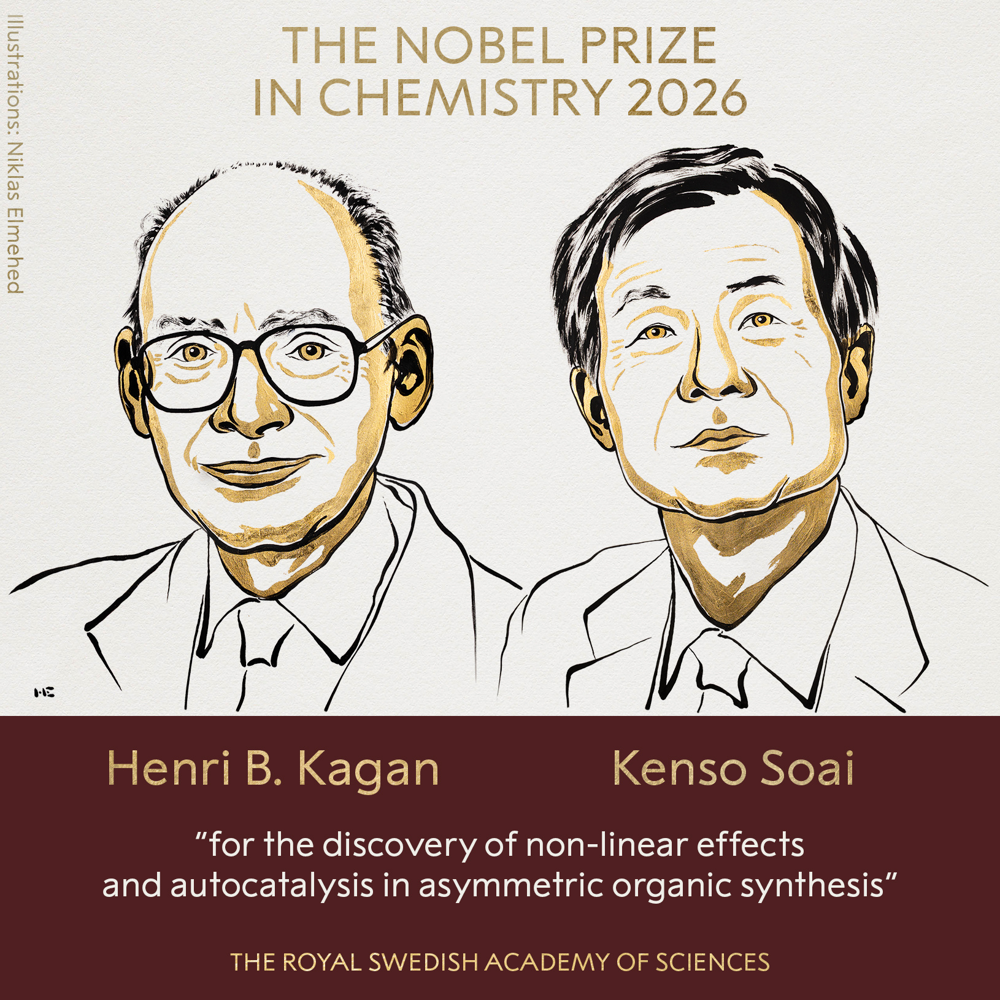

## Ruby

<ruby>Chemistry<rt>ˈkemɪstri</rt></ruby> <ruby>Nobel<rt>noʊˈbel</rt></ruby> <ruby>awarded<rt>əˈwɔːrdɪd</rt></ruby> for <ruby>solving<rt>ˈsɑːlvɪŋ</rt></ruby> <ruby>mystery<rt>ˈmɪstəri</rt></ruby> of life'<ruby>s<rt>laɪfz</rt></ruby> <ruby>asymmetry<rt>eɪˈsɪmətri</rt></ruby>.

The <ruby>Nobel<rt>noʊˈbel</rt></ruby> <ruby>Prize<rt>praɪz</rt></ruby> in <ruby>Chemistry<rt>ˈkemɪstri</rt></ruby> has been <ruby>awarded<rt>əˈwɔːrdɪd</rt></ruby> to <ruby>French<rt>frentʃ</rt></ruby> <ruby>scientist<rt>ˈsaɪəntɪst</rt></ruby> Henri B. Kagan and <ruby>Japan's<rt>dʒəˈpænz</rt></ruby> Kenso Soai for <ruby>providing<rt>prəˈvaɪdɪŋ</rt></ruby> a <ruby>solution<rt>səˈluːʃn</rt></ruby> to the <ruby>chemical<rt>ˈkemɪkl</rt></ruby> <ruby>mystery<rt>ˈmɪstəri</rt></ruby> of <ruby>life's<rt>laɪfz</rt></ruby> <ruby>asymmetry<rt>eɪˈsɪmətri</rt></ruby>. The <ruby>researchers<rt>ˈriːsɜːrtʃərz</rt></ruby> <ruby>discovered<rt>dɪˈskʌvərd</rt></ruby> how <ruby>nature<rt>ˈneɪtʃər</rt></ruby> <ruby>exclusively<rt>ɪkˈskluːsɪvli</rt></ruby> <ruby>makes<rt>meɪks</rt></ruby> the <ruby>correct<rt>kəˈrekt</rt></ruby> <ruby>version<rt>ˈvɜːrʒn</rt></ruby> of a <ruby>molecule<rt>ˈmɑːlɪkjuːl</rt></ruby> - rather than its <ruby>mirror<rt>ˈmɪrər</rt></ruby> <ruby>image<rt>ˈɪmɪdʒ</rt></ruby>. For example, <ruby>amino<rt>əˈmiːnoʊ</rt></ruby> <ruby>acid<rt>ˈæsɪd</rt></ruby> <ruby>molecules<rt>ˈmɑːlɪkjuːlz</rt></ruby>, the <ruby>building<rt>ˈbɪldɪŋ</rt></ruby> <ruby>blocks<rt>blɑːks</rt></ruby> of <ruby>proteins<rt>ˈproʊtiːnz</rt></ruby>, <ruby>exist<rt>ɪɡˈzɪst</rt></ruby> as two <ruby>forms<rt>fɔːrmz</rt></ruby> that are each other's <ruby>mirror<rt>ˈmɪrər</rt></ruby> <ruby>image<rt>ˈɪmɪdʒ</rt></ruby>. But <ruby>living<rt>ˈlɪvɪŋ</rt></ruby> <ruby>organisms<rt>ˈɔːrɡənɪzəmz</rt></ruby> on <ruby>Earth<rt>ɜːrθ</rt></ruby> only <ruby>function<rt>ˈfʌŋkʃn</rt></ruby> with one of those <ruby>forms<rt>fɔːrmz</rt></ruby>. The <ruby>Nobel<rt>noʊˈbel</rt></ruby> <ruby>laureates<rt>ˈlɔːriəts</rt></ruby> <ruby>answered<rt>ˈænsərd</rt></ruby> the <ruby>question<rt>ˈkwestʃn</rt></ruby>: why does <ruby>life<rt>laɪf</rt></ruby> <ruby>favour<rt>ˈfeɪvər</rt></ruby> just one of these <ruby>mirror<rt>ˈmɪrər</rt></ruby> <ruby>image<rt>ˈɪmɪdʒ</rt></ruby> <ruby>molecules<rt>ˈmɑːlɪkjuːlz</rt></ruby> over the <ruby>other<rt>ˈʌðər</rt></ruby>. In <ruby>organic<rt>ɔːrˈɡænɪk</rt></ruby> <ruby>chemistry<rt>ˈkemɪstri</rt></ruby>, this <ruby>property<rt>ˈprɑːpərti</rt></ruby> is <ruby>known<rt>noʊn</rt></ruby> as <ruby>"chirality"<rt>kaɪˈræləti</rt></ruby>, so <ruby>chiral<rt>ˈkaɪrəl</rt></ruby> <ruby>molecules<rt>ˈmɑːlɪkjuːlz</rt></ruby> have both <ruby>right<rt>raɪt</rt></ruby> and left-<ruby>handed<rt>ˌleftˈhændɪd</rt></ruby> <ruby>forms<rt>fɔːrmz</rt></ruby>. You can <ruby>think<rt>θɪŋk</rt></ruby> of them as <ruby>looking<rt>ˈlʊkɪŋ</rt></ruby> like our <ruby>hands<rt>hændz</rt></ruby> - not <ruby>identical<rt>aɪˈdentɪkl</rt></ruby>, but each a <ruby>mirror<rt>ˈmɪrər</rt></ruby> <ruby>image<rt>ˈɪmɪdʒ</rt></ruby> of the <ruby>other<rt>ˈʌðər</rt></ruby>. And while <ruby>nature<rt>ˈneɪtʃər</rt></ruby> <ruby>almost<rt>ˈɔːlmoʊst</rt></ruby> <ruby>exclusively<rt>ɪkˈskluːsɪvli</rt></ruby> <ruby>produces<rt>prəˈduːsɪz</rt></ruby> the <ruby>version<rt>ˈvɜːrʒn</rt></ruby> it <ruby>requires<rt>rɪˈkwaɪərz</rt></ruby> to <ruby>function<rt>ˈfʌŋkʃn</rt></ruby>, <ruby>chemical<rt>ˈkemɪkl</rt></ruby> <ruby>reactions<rt>riˈækʃnz</rt></ruby> in a <ruby>lab<rt>læb</rt></ruby> <ruby>usually<rt>ˈjuːʒuəli</rt></ruby> <ruby>create<rt>kriˈeɪt</rt></ruby> a 50-50 <ruby>mix<rt>mɪks</rt></ruby> of both left- and right-<ruby>handed<rt>ˈhændɪd</rt></ruby> <ruby>molecules<rt>ˈmɑːlɪkjuːlz</rt></ruby>. When it comes to <ruby>making<rt>ˈmeɪkɪŋ</rt></ruby> <ruby>drugs<rt>drʌɡz</rt></ruby>, this is <ruby>particularly<rt>pərˈtɪkjələrli</rt></ruby> <ruby>significant<rt>sɪɡˈnɪfɪkənt</rt></ruby>, because each <ruby>version<rt>ˈvɜːrʒn</rt></ruby> <ruby>behaves<rt>bɪˈheɪvz</rt></ruby> <ruby>differently<rt>ˈdɪfrəntli</rt></ruby> when it <ruby>interacts<rt>ˌɪntərˈækts</rt></ruby> with our <ruby>bodies<rt>ˈbɑːdiz</rt></ruby>. So, one might have <ruby>disease-fighting<rt>dɪˈziːzˌfaɪtɪŋ</rt></ruby> <ruby>properties<rt>ˈprɑːpərtiz</rt></ruby>, while the other <ruby>version<rt>ˈvɜːrʒn</rt></ruby> does <ruby>nothing<rt>ˈnʌθɪŋ</rt></ruby> or even <ruby>causes<rt>ˈkɔːzɪz</rt></ruby> <ruby>harm<rt>hɑːrm</rt></ruby>. The <ruby>development<rt>dɪˈveləpmənt</rt></ruby> of the <ruby>Thalidomide<rt>θəˈlɪdəmaɪd</rt></ruby> <ruby>drug<rt>drʌɡ</rt></ruby> is an <ruby>example<rt>ɪɡˈzæmpl</rt></ruby> of this. In the 1950s it was <ruby>prescribed<rt>prɪˈskraɪbd</rt></ruby> to <ruby>pregnant<rt>ˈpreɡnənt</rt></ruby> <ruby>women<rt>ˈwɪmɪn</rt></ruby> <ruby>suffering<rt>ˈsʌfərɪŋ</rt></ruby> with <ruby>morning<rt>ˈmɔːrnɪŋ</rt></ruby> <ruby>sickness<rt>ˈsɪknəs</rt></ruby>. But it is a <ruby>chiral<rt>ˈkaɪrəl</rt></ruby> <ruby>molecule<rt>ˈmɑːlɪkjuːl</rt></ruby> - the right-<ruby>handed<rt>ˌraɪtˈhændɪd</rt></ruby> <ruby>version<rt>ˈvɜːrʒn</rt></ruby> is an <ruby>effective<rt>ɪˈfektɪv</rt></ruby> <ruby>treatment<rt>ˈtriːtmənt</rt></ruby>, but the <ruby>left-hand<rt>ˌleftˈhænd</rt></ruby> is <ruby>toxic<rt>ˈtɑːksɪk</rt></ruby>.

The <ruby>original<rt>əˈrɪdʒənl</rt></ruby> <ruby>drug<rt>drʌɡ</rt></ruby> <ruby>given<rt>ˈɡɪvn</rt></ruby> was a <ruby>mixture<rt>ˈmɪkstʃər</rt></ruby> of the two, and it was <ruby>later<rt>ˈleɪtər</rt></ruby> <ruby>discovered<rt>dɪˈskʌvərd</rt></ruby> that the <ruby>body<rt>ˈbɑːdi</rt></ruby> will <ruby>convert<rt>kənˈvɜːrt</rt></ruby> between the two. The <ruby>result<rt>rɪˈzʌlt</rt></ruby> was <ruby>thousands<rt>ˈθaʊzndz</rt></ruby> of <ruby>children<rt>ˈtʃɪldrən</rt></ruby>, <ruby>born<rt>bɔːrn</rt></ruby> to <ruby>women<rt>ˈwɪmɪn</rt></ruby> who <ruby>took<rt>tʊk</rt></ruby> the <ruby>drug<rt>drʌɡ</rt></ruby>, <ruby>developed<rt>dɪˈveləpt</rt></ruby> <ruby>severe<rt>sɪˈvɪr</rt></ruby> <ruby>disabilities<rt>ˌdɪsəˈbɪlətiz</rt></ruby>. <ruby>Speaking<rt>ˈspiːkɪŋ</rt></ruby> to the <ruby>Nobel<rt>noʊˈbel</rt></ruby> <ruby>Prize<rt>praɪz</rt></ruby> <ruby>press<rt>pres</rt></ruby> <ruby>conference<rt>ˈkɑːnfərəns</rt></ruby> this <ruby>morning<rt>ˈmɔːrnɪŋ</rt></ruby> over the <ruby>phone<rt>foʊn</rt></ruby>, Kenso Soai <ruby>said<rt>sed</rt></ruby>: "This is one of the most <ruby>exciting<rt>ɪkˈsaɪtɪŋ</rt></ruby> <ruby>days<rt>deɪz</rt></ruby> of my <ruby>life<rt>laɪf</rt></ruby>." By <ruby>solving<rt>ˈsɑːlvɪŋ</rt></ruby> the <ruby>mystery<rt>ˈmɪstəri</rt></ruby> of <ruby>chirality<rt>kaɪˈræləti</rt></ruby>, Henri Kagan and Kenso Soai <ruby>worked<rt>wɜːrkt</rt></ruby> out how to <ruby>design<rt>dɪˈzaɪn</rt></ruby> <ruby>chemical<rt>ˈkemɪkl</rt></ruby> <ruby>reactions<rt>riˈækʃnz</rt></ruby> to <ruby>produce<rt>prəˈduːs</rt></ruby> much more of the <ruby>desired<rt>dɪˈzaɪərd</rt></ruby> <ruby>version<rt>ˈvɜːrʒn</rt></ruby> of a <ruby>molecule<rt>ˈmɑːlɪkjuːl</rt></ruby>. Heiner Linke, <ruby>chair<rt>tʃer</rt></ruby> of the <ruby>Nobel<rt>noʊˈbel</rt></ruby> <ruby>Committee<rt>kəˈmɪti</rt></ruby> for <ruby>Chemistry<rt>ˈkemɪstri</rt></ruby>, <ruby>explained<rt>ɪkˈspleɪnd</rt></ruby>: "Henri Kagan and Kenso Soai have <ruby>provided<rt>prəˈvaɪdɪd</rt></ruby> a <ruby>solution<rt>səˈluːʃn</rt></ruby> to a <ruby>chemical<rt>ˈkemɪkl</rt></ruby> <ruby>mystery<rt>ˈmɪstəri</rt></ruby> that is over a <ruby>century<rt>ˈsentʃəri</rt></ruby> <ruby>old<rt>oʊld</rt></ruby>: how <ruby>homochirality<rt>ˌhoʊmoʊkaɪˈræləti</rt></ruby> - the <ruby>selective<rt>sɪˈlektɪv</rt></ruby> <ruby>production<rt>prəˈdʌkʃn</rt></ruby> of the <ruby>correct<rt>kəˈrekt</rt></ruby> <ruby>version<rt>ˈvɜːrʒn</rt></ruby> of a <ruby>molecule<rt>ˈmɑːlɪkjuːl</rt></ruby> - can <ruby>emerge<rt>ɪˈmɜːrdʒ</rt></ruby> <ruby>spontaneously<rt>spɑːnˈteɪniəsli</rt></ruby>. The <ruby>chemical<rt>ˈkemɪkl</rt></ruby> <ruby>reactions<rt>riˈækʃnz</rt></ruby> they have <ruby>developed<rt>dɪˈveləpt</rt></ruby> are <ruby>spectacular<rt>spekˈtækjələr</rt></ruby>." Henri Kagan, who is at <ruby>Université<rt>ˌjuːnɪverˈsiːteɪ</rt></ruby> <ruby>Paris-Sud<rt>ˈpærɪs sjuːd</rt></ruby>, <ruby>first<rt>fɜːrst</rt></ruby> <ruby>discovered<rt>dɪˈskʌvərd</rt></ruby> a <ruby>new<rt>nuː</rt></ruby> <ruby>way<rt>weɪ</rt></ruby> of <ruby>manipulating<rt>məˈnɪpjuleɪtɪŋ</rt></ruby> <ruby>chemical<rt>ˈkemɪkl</rt></ruby> <ruby>reactions<rt>riˈækʃnz</rt></ruby> in 1986. This <ruby>allowed<rt>əˈlaʊd</rt></ruby> him to <ruby>create<rt>kriˈeɪt</rt></ruby> a <ruby>greater<rt>ˈɡreɪtər</rt></ruby> <ruby>excess<rt>ɪkˈses</rt></ruby> of one of the <ruby>mirror<rt>ˈmɪrər</rt></ruby> <ruby>images<rt>ˈɪmɪdʒɪz</rt></ruby> than had <ruby>previously<rt>ˈpriːviəsli</rt></ruby> been <ruby>thought<rt>θɔːt</rt></ruby> <ruby>possible<rt>ˈpɑːsəbl</rt></ruby>.

Kenso Soai from <ruby>Tokyo<rt>ˈtoʊkioʊ</rt></ruby> <ruby>University<rt>ˌjuːnɪˈvɜːrsəti</rt></ruby> of <ruby>Science<rt>ˈsaɪəns</rt></ruby> <ruby>took<rt>tʊk</rt></ruby> the <ruby>next<rt>nekst</rt></ruby> <ruby>step<rt>step</rt></ruby> in 1995. He <ruby>published<rt>ˈpʌblɪʃt</rt></ruby> a <ruby>scientific<rt>ˌsaɪənˈtɪfɪk</rt></ruby> <ruby>paper<rt>ˈpeɪpər</rt></ruby> in the <ruby>journal<rt>ˈdʒɜːrnl</rt></ruby> <ruby>Nature<rt>ˈneɪtʃər</rt></ruby> <ruby>describing<rt>dɪˈskraɪbɪŋ</rt></ruby> the <ruby>first<rt>fɜːrst</rt></ruby> ever <ruby>chemical<rt>ˈkemɪkl</rt></ruby> <ruby>reaction<rt>riˈækʃn</rt></ruby> that had the <ruby>potential<rt>pəˈtenʃl</rt></ruby> to be <ruby>homochiral<rt>ˌhoʊmoʊˈkaɪrəl</rt></ruby> - <ruby>producing<rt>prəˈduːsɪŋ</rt></ruby> only the <ruby>desired<rt>dɪˈzaɪərd</rt></ruby> <ruby>version<rt>ˈvɜːrʒn</rt></ruby> of an <ruby>organic<rt>ɔːrˈɡænɪk</rt></ruby> <ruby>molecule<rt>ˈmɑːlɪkjuːl</rt></ruby>. In 2003, he <ruby>finally<rt>ˈfaɪnəli</rt></ruby> <ruby>succeeded<rt>səkˈsiːdɪd</rt></ruby> in <ruby>controlling<rt>kənˈtroʊlɪŋ</rt></ruby> a <ruby>reaction<rt>riˈækʃn</rt></ruby> in which only one of the two <ruby>possible<rt>ˈpɑːsəbl</rt></ruby> <ruby>mirror<rt>ˈmɪrər</rt></ruby> <ruby>images<rt>ˈɪmɪdʒɪz</rt></ruby> was <ruby>formed<rt>fɔːrmd</rt></ruby>. "Other than <ruby>life<rt>laɪf</rt></ruby> itself," the <ruby>Nobel<rt>noʊˈbel</rt></ruby> <ruby>Committee<rt>kəˈmɪti</rt></ruby> <ruby>said<rt>sed</rt></ruby> in a <ruby>statement<rt>ˈsteɪtmənt</rt></ruby>, "no one had <ruby>previously<rt>ˈpriːviəsli</rt></ruby> <ruby>achieved<rt>əˈtʃiːvd</rt></ruby> this <ruby>feat<rt>fiːt</rt></ruby>". At the <ruby>press<rt>pres</rt></ruby> <ruby>conference<rt>ˈkɑːnfərəns</rt></ruby> on <ruby>Wednesday<rt>ˈwenzdeɪ</rt></ruby>, Kenso Soai <ruby>praised<rt>preɪzd</rt></ruby> the "<ruby>many<rt>ˈmeni</rt></ruby>, <ruby>many<rt>ˈmeni</rt></ruby> <ruby>excellent<rt>ˈeksələnt</rt></ruby> <ruby>researchers<rt>ˈriːsɜːrtʃərz</rt></ruby>" in this <ruby>field<rt>fiːld</rt></ruby>. <ruby>Professor<rt>prəˈfesər</rt></ruby> Robert Mokaya, <ruby>president<rt>ˈprezɪdənt</rt></ruby> of the UK's <ruby>Royal<rt>ˈrɔɪəl</rt></ruby> <ruby>Society<rt>səˈsaɪəti</rt></ruby> of <ruby>Chemistry<rt>ˈkemɪstri</rt></ruby> <ruby>said<rt>sed</rt></ruby> it was a "<ruby>powerful<rt>ˈpaʊərfl</rt></ruby> <ruby>example<rt>ɪɡˈzæmpl</rt></ruby> of how <ruby>fundamental<rt>ˌfʌndəˈmentl</rt></ruby> <ruby>chemistry<rt>ˈkemɪstri</rt></ruby> can <ruby>underpin<rt>ˌʌndərˈpɪn</rt></ruby> <ruby>solutions<rt>səˈluːʃnz</rt></ruby> to some of the <ruby>biggest<rt>ˈbɪɡɪst</rt></ruby> <ruby>challenges<rt>ˈtʃælɪndʒɪz</rt></ruby> <ruby>facing<rt>ˈfeɪsɪŋ</rt></ruby> <ruby>society<rt>səˈsaɪəti</rt></ruby>". "<ruby>Different<rt>ˈdɪfrənt</rt></ruby> <ruby>isomers<rt>ˈaɪsəmərz</rt></ruby> (or <ruby>versions<rt>ˈvɜːrʒnz</rt></ruby> of <ruby>molecules<rt>ˈmɑːlɪkjuːlz</rt></ruby>) can have <ruby>completely<rt>kəmˈpliːtli</rt></ruby> <ruby>different<rt>ˈdɪfrənt</rt></ruby> <ruby>biological<rt>ˌbaɪəˈlɑːdʒɪkl</rt></ruby> and <ruby>physical<rt>ˈfɪzɪkl</rt></ruby> <ruby>effects<rt>ɪˈfekts</rt></ruby>, so they are <ruby>crucial<rt>ˈkruːʃl</rt></ruby> in <ruby>finding<rt>ˈfaɪndɪŋ</rt></ruby> <ruby>effective<rt>ɪˈfektɪv</rt></ruby> <ruby>medicines<rt>ˈmedɪsnz</rt></ruby> to <ruby>treat<rt>triːt</rt></ruby> all <ruby>sorts<rt>sɔːrts</rt></ruby> of <ruby>illnesses<rt>ˈɪlnəsɪz</rt></ruby>," he <ruby>added<rt>ˈædɪd</rt></ruby>. Prof Angus Davison, from the <ruby>University<rt>ˌjuːnɪˈvɜːrsəti</rt></ruby> of <ruby>Nottingham<rt>ˈnɑːtɪŋəm</rt></ruby>, <ruby>studies<rt>ˈstʌdiz</rt></ruby> the <ruby>biology<rt>baɪˈɑːlədʒi</rt></ruby> of <ruby>chirality<rt>kaɪˈræləti</rt></ruby> and <ruby>said<rt>sed</rt></ruby> that the Nobel-<ruby>winning<rt>noʊˈbelˌwɪnɪŋ</rt></ruby> <ruby>chemistry<rt>ˈkemɪstri</rt></ruby> could <ruby>help<rt>help</rt></ruby> <ruby>reveal<rt>rɪˈviːl</rt></ruby> how and why <ruby>life<rt>laɪf</rt></ruby> <ruby>favours<rt>ˈfeɪvərz</rt></ruby> <ruby>"one-handedness"<rt>ˌwʌnˈhændɪdnəs</rt></ruby>.

"In <ruby>ways<rt>weɪz</rt></ruby> that we don't <ruby>yet<rt>jet</rt></ruby> <ruby>quite<rt>kwaɪt</rt></ruby> <ruby>understand<rt>ˌʌndərˈstænd</rt></ruby>, the <ruby>chirality<rt>kaɪˈræləti</rt></ruby> of the <ruby>basic<rt>ˈbeɪsɪk</rt></ruby> <ruby>building<rt>ˈbɪldɪŋ</rt></ruby> <ruby>blocks<rt>blɑːks</rt></ruby> of <ruby>life<rt>laɪf</rt></ruby> <ruby>ends<rt>endz</rt></ruby> up <ruby>making<rt>ˈmeɪkɪŋ</rt></ruby> <ruby>bodies<rt>ˈbɑːdiz</rt></ruby> that are themselves <ruby>also<rt>ˈɔːlsoʊ</rt></ruby> <ruby>chiral<rt>ˈkaɪrəl</rt></ruby>," he <ruby>told<rt>toʊld</rt></ruby> BBC <ruby>News<rt>nuːz</rt></ruby>. This was the <ruby>foundation<rt>faʊnˈdeɪʃn</rt></ruby>, he <ruby>explained<rt>ɪkˈspleɪnd</rt></ruby>, of our <ruby>hearts<rt>hɑːrts</rt></ruby> being on <ruby>left<rt>left</rt></ruby> <ruby>hand<rt>hænd</rt></ruby> <ruby>side<rt>saɪd</rt></ruby> of our <ruby>bodies<rt>ˈbɑːdiz</rt></ruby> and <ruby>snail<rt>sneɪl</rt></ruby> <ruby>shells<rt>ʃelz</rt></ruby> that <ruby>coil<rt>kɔɪl</rt></ruby> to the <ruby>right<rt>raɪt</rt></ruby>. Peter Somfai, a <ruby>member<rt>ˈmembər</rt></ruby> of the <ruby>Nobel<rt>noʊˈbel</rt></ruby> <ruby>Committee<rt>kəˈmɪti</rt></ruby> for <ruby>Chemistry<rt>ˈkemɪstri</rt></ruby>, <ruby>said<rt>sed</rt></ruby> the <ruby>research<rt>ˈriːsɜːrtʃ</rt></ruby> <ruby>awarded<rt>əˈwɔːrdɪd</rt></ruby> this year's <ruby>prize<rt>praɪz</rt></ruby> has <ruby>become<rt>bɪˈkʌm</rt></ruby> <ruby>part<rt>pɑːrt</rt></ruby> of "our <ruby>basic<rt>ˈbeɪsɪk</rt></ruby> <ruby>understanding<rt>ˌʌndərˈstændɪŋ</rt></ruby> of how <ruby>chemistry<rt>ˈkemɪstri</rt></ruby> <ruby>functions<rt>ˈfʌŋkʃnz</rt></ruby>". He <ruby>said<rt>sed</rt></ruby> <ruby>showing<rt>ˈʃoʊɪŋ</rt></ruby> how a <ruby>mirror<rt>ˈmɪrər</rt></ruby> <ruby>image<rt>ˈɪmɪdʒ</rt></ruby> is <ruby>created<rt>kriˈeɪtɪd</rt></ruby> is "<ruby>probably<rt>ˈprɑːbəbli</rt></ruby> the most <ruby>fundamental<rt>ˌfʌndəˈmentl</rt></ruby> <ruby>question<rt>ˈkwestʃn</rt></ruby> in <ruby>life<rt>laɪf</rt></ruby> - because <ruby>somehow<rt>ˈsʌmhaʊ</rt></ruby> that <ruby>happened<rt>ˈhæpənd</rt></ruby> four <ruby>billion<rt>ˈbɪljən</rt></ruby> <ruby>years<rt>jɪrz</rt></ruby> <ruby>ago<rt>əˈɡoʊ</rt></ruby> when <ruby>life<rt>laɪf</rt></ruby> was <ruby>created<rt>kriˈeɪtɪd</rt></ruby>. And <ruby>now<rt>naʊ</rt></ruby> we have, for the first <ruby>time<rt>taɪm</rt></ruby>, <ruby>mimicked<rt>ˈmɪmɪkt</rt></ruby> that in the <ruby>lab<rt>læb</rt></ruby>".

## 标题句

**# 1. 带美音音标**
Chemistry[ˈkemɪstri] Nobel[noʊˈbel] awarded[əˈwɔːrdɪd] for solving[ˈsɑːlvɪŋ] mystery[ˈmɪstəri] of life's[laɪfz] asymmetry[eɪˈsɪmətri].

**# 2. 固定搭配 & 短语释义**
1. Nobel Prize in Chemistry：诺贝尔化学奖
2. solve the mystery of：解开……之谜
3. life's asymmetry：生命的不对称性

**# 3. 整句中文释义**
诺贝尔化学奖颁发给解开生命不对称性之谜的研究。

---

## 第 2 段

**# 1. 带美音音标**
The Nobel[noʊˈbel] Prize[praɪz] in Chemistry[ˈkemɪstri] has been awarded[əˈwɔːrdɪd] to French[frentʃ] scientist[ˈsaɪəntɪst] Henri B. Kagan and Japan's[dʒəˈpænz] Kenso Soai for providing[prəˈvaɪdɪŋ] a solution[səˈluːʃn] to the chemical[ˈkemɪkl] mystery[ˈmɪstəri] of life's[laɪfz] asymmetry[eɪˈsɪmətri]. The researchers[ˈriːsɜːrtʃərz] discovered[dɪˈskʌvərd] how nature[ˈneɪtʃər] exclusively[ɪkˈskluːsɪvli] makes[meɪks] the correct[kəˈrekt] version[ˈvɜːrʒn] of a molecule[ˈmɑːlɪkjuːl] - rather than its mirror[ˈmɪrər] image[ˈɪmɪdʒ]. For example, amino[əˈmiːnoʊ] acid[ˈæsɪd] molecules[ˈmɑːlɪkjuːlz], the building[ˈbɪldɪŋ] blocks[blɑːks] of proteins[ˈproʊtiːnz], exist[ɪɡˈzɪst] as two forms[fɔːrmz] that are each other's mirror[ˈmɪrər] image[ˈɪmɪdʒ]. But living[ˈlɪvɪŋ] organisms[ˈɔːrɡənɪzəmz] on Earth[ɜːrθ] only function[ˈfʌŋkʃn] with one of those forms[fɔːrmz]. The Nobel[noʊˈbel] laureates[ˈlɔːriəts] answered[ˈænsərd] the question[ˈkwestʃn]: why does life[laɪf] favour[ˈfeɪvər] just one of these mirror[ˈmɪrər] image[ˈɪmɪdʒ] molecules[ˈmɑːlɪkjuːlz] over the other[ˈʌðər]. In organic[ɔːrˈɡænɪk] chemistry[ˈkemɪstri], this property[ˈprɑːpərti] is known[noʊn] as "chirality"[kaɪˈræləti], so chiral[ˈkaɪrəl] molecules[ˈmɑːlɪkjuːlz] have both right[raɪt] and left-handed[ˌleftˈhændɪd] forms[fɔːrmz]. You can think[θɪŋk] of them as looking[ˈlʊkɪŋ] like our hands[hændz] - not identical[aɪˈdentɪkl], but each a mirror[ˈmɪrər] image[ˈɪmɪdʒ] of the other[ˈʌðər]. And while nature[ˈneɪtʃər] almost[ˈɔːlmoʊst] exclusively[ɪkˈskluːsɪvli] produces[prəˈduːsɪz] the version[ˈvɜːrʒn] it requires[rɪˈkwaɪərz] to function[ˈfʌŋkʃn], chemical[ˈkemɪkl] reactions[riˈækʃnz] in a lab[læb] usually[ˈjuːʒuəli] create[kriˈeɪt] a 50-50 mix[mɪks] of both left- and right-handed[ˈhændɪd] molecules[ˈmɑːlɪkjuːlz]. When it comes to making[ˈmeɪkɪŋ] drugs[drʌɡz], this is particularly[pərˈtɪkjələrli] significant[sɪɡˈnɪfɪkənt], because each version[ˈvɜːrʒn] behaves[bɪˈheɪvz] differently[ˈdɪfrəntli] when it interacts[ˌɪntərˈækts] with our bodies[ˈbɑːdiz]. So, one might have disease-fighting[dɪˈziːzˌfaɪtɪŋ] properties[ˈprɑːpərtiz], while the other version[ˈvɜːrʒn] does nothing[ˈnʌθɪŋ] or even causes[ˈkɔːzɪz] harm[hɑːrm]. The development[dɪˈveləpmənt] of the Thalidomide[θəˈlɪdəmaɪd] drug[drʌɡ] is an example[ɪɡˈzæmpl] of this. In the 1950s it was prescribed[prɪˈskraɪbd] to pregnant[ˈpreɡnənt] women[ˈwɪmɪn] suffering[ˈsʌfərɪŋ] with morning[ˈmɔːrnɪŋ] sickness[ˈsɪknəs]. But it is a chiral[ˈkaɪrəl] molecule[ˈmɑːlɪkjuːl] - the right-handed[ˌraɪtˈhændɪd] version[ˈvɜːrʒn] is an effective[ɪˈfektɪv] treatment[ˈtriːtmənt], but the left-hand[ˌleftˈhænd] is toxic[ˈtɑːksɪk].

**# 2. 固定搭配 & 短语释义**
1. Nobel Prize in Chemistry：诺贝尔化学奖
2. provide a solution to：为……提供解决方案
3. the correct version of a molecule：分子的正确版本
4. rather than：而不是
5. mirror image：镜像
6. amino acid：氨基酸
7. the building blocks of：……的构建单元
8. living organisms：生命有机体
9. the Nobel laureates：诺贝尔奖得主
10. organic chemistry：有机化学
11. known as：被称为
12. chiral molecules：手性分子
13. left-handed / right-handed forms：左手型/右手型
14. a 50-50 mix：各占一半的混合物
15. when it comes to：说到、谈到
16. interact with：与……相互作用
17. disease-fighting properties：抗病特性
18. cause harm：造成伤害
19. be prescribed to：被开具给、被用于
20. pregnant women：孕妇
21. morning sickness：孕吐、妊娠晨吐
22. an effective treatment：有效疗法
23. be toxic：有毒的

**# 3. 整句中文释义**
诺贝尔化学奖已颁发给法国科学家亨利·B.卡根和日本科学家小杉谦三（Kenso Soai），因为他们为生命不对称性的化学之谜提供了解决方案。这两位研究者发现了大自然如何只制造分子的正确版本——而非其镜像。例如，作为蛋白质构建单元的氨基酸分子以两种互为镜像的形式存在。但地球上的生命有机体只使用其中一种形式来运转。这两位诺贝尔奖得主回答了这样一个问题：为什么生命只偏爱这些镜像分子中的一种，而不是另一种。在有机化学中，这一性质被称为"手性"，因此手性分子同时具有右手型和左手型两种形式。你可以把它们想象成我们的双手——并不完全相同，但彼此互为镜像。而且，尽管大自然几乎只制造它运转所需的那种版本，但实验室里的化学反应通常会同时生成左右两种分子各占一半的混合物。说到制药，这一点尤为重要，因为每种版本在与人体相互作用时表现不同。因此，一种可能具有抗病特性，而另一种则毫无作用，甚至造成伤害。沙利度胺（Thalidomide）药物的开发就是这样一个例子。20世纪50年代，它被开给患有孕吐的孕妇。但它是一种手性分子——右手型是有效的治疗手段，而左手型则是有毒的。

---

## 第 3 段

**# 1. 带美音音标**
The original[əˈrɪdʒənl] drug[drʌɡ] given[ˈɡɪvn] was a mixture[ˈmɪkstʃər] of the two, and it was later[ˈleɪtər] discovered[dɪˈskʌvərd] that the body[ˈbɑːdi] will convert[kənˈvɜːrt] between the two. The result[rɪˈzʌlt] was thousands[ˈθaʊzndz] of children[ˈtʃɪldrən], born[bɔːrn] to women[ˈwɪmɪn] who took[tʊk] the drug[drʌɡ], developed[dɪˈveləpt] severe[sɪˈvɪr] disabilities[ˌdɪsəˈbɪlətiz]. Speaking[ˈspiːkɪŋ] to the Nobel[noʊˈbel] Prize[praɪz] press[pres] conference[ˈkɑːnfərəns] this morning[ˈmɔːrnɪŋ] over the phone[foʊn], Kenso Soai said[sed]: "This is one of the most exciting[ɪkˈsaɪtɪŋ] days[deɪz] of my life[laɪf]." By solving[ˈsɑːlvɪŋ] the mystery[ˈmɪstəri] of chirality[kaɪˈræləti], Henri Kagan and Kenso Soai worked[wɜːrkt] out how to design[dɪˈzaɪn] chemical[ˈkemɪkl] reactions[riˈækʃnz] to produce[prəˈduːs] much more of the desired[dɪˈzaɪərd] version[ˈvɜːrʒn] of a molecule[ˈmɑːlɪkjuːl]. Heiner Linke, chair[tʃer] of the Nobel[noʊˈbel] Committee[kəˈmɪti] for Chemistry[ˈkemɪstri], explained[ɪkˈspleɪnd]: "Henri Kagan and Kenso Soai have provided[prəˈvaɪdɪd] a solution[səˈluːʃn] to a chemical[ˈkemɪkl] mystery[ˈmɪstəri] that is over a century[ˈsentʃəri] old[oʊld]: how homochirality[ˌhoʊmoʊkaɪˈræləti] - the selective[sɪˈlektɪv] production[prəˈdʌkʃn] of the correct[kəˈrekt] version[ˈvɜːrʒn] of a molecule[ˈmɑːlɪkjuːl] - can emerge[ɪˈmɜːrdʒ] spontaneously[spɑːnˈteɪniəsli]. The chemical[ˈkemɪkl] reactions[riˈækʃnz] they have developed[dɪˈveləpt] are spectacular[spekˈtækjələr]." Henri Kagan, who is at Université[ˌjuːnɪverˈsiːteɪ] Paris-Sud[ˈpærɪs sjuːd], first[fɜːrst] discovered[dɪˈskʌvərd] a new[nuː] way[weɪ] of manipulating[məˈnɪpjuleɪtɪŋ] chemical[ˈkemɪkl] reactions[riˈækʃnz] in 1986. This allowed[əˈlaʊd] him to create[kriˈeɪt] a greater[ˈɡreɪtər] excess[ɪkˈses] of one of the mirror[ˈmɪrər] images[ˈɪmɪdʒɪz] than had previously[ˈpriːviəsli] been thought[θɔːt] possible[ˈpɑːsəbl].

**# 2. 固定搭配 & 短语释义**
1. a mixture of：……的混合物
2. convert between：在……之间转换
3. severe disabilities：严重残疾
4. press conference：新闻发布会
5. over the phone：通过电话
6. the most exciting days：最激动人心的日子
7. work out how：弄清楚如何
8. design chemical reactions：设计化学反应
9. the desired version：所需的版本
10. chair of the committee：委员会主席
11. over a century old：逾一个世纪之久
12. emerge spontaneously：自发地产生
13. manipulate chemical reactions：操控化学反应
14. a greater excess of：更大比例、更大量
15. previously been thought possible：此前被认为可能

**# 3. 整句中文释义**
最初投放的药物是两种版本的混合物，后来人们发现人体会在两者之间相互转化。结果是，服用了该药的妇女所生的数千名儿童出现了严重残疾。小杉谦三今早通过电话在诺贝尔奖新闻发布会上说："这是我一生中最激动人心的日子之一。"通过解开手性之谜，亨利·卡根和小杉谦三弄清了如何设计化学反应，以产出远多于所需的分子版本。诺贝尔化学委员会主席海纳·林克解释说："亨利·卡根和小杉谦三为一个已有一百多年历史的化学之谜提供了解决方案：同手性——即选择性制造分子的正确版本——如何能够自发地产生。他们开发的化学反应令人惊叹。"任职于巴黎南大学的亨利·卡根于1986年首次发现了一种操控化学反应的新方法。这使他能够制造出一种镜像成分的过量，其程度超出此前人们认为可能的范围。

---

## 第 4 段

**# 1. 带美音音标**
Kenso Soai from Tokyo[ˈtoʊkioʊ] University[ˌjuːnɪˈvɜːrsəti] of Science[ˈsaɪəns] took[tʊk] the next[nekst] step[step] in 1995. He published[ˈpʌblɪʃt] a scientific[ˌsaɪənˈtɪfɪk] paper[ˈpeɪpər] in the journal[ˈdʒɜːrnl] Nature[ˈneɪtʃər] describing[dɪˈskraɪbɪŋ] the first[fɜːrst] ever chemical[ˈkemɪkl] reaction[riˈækʃn] that had the potential[pəˈtenʃl] to be homochiral[ˌhoʊmoʊˈkaɪrəl] - producing[prəˈduːsɪŋ] only the desired[dɪˈzaɪərd] version[ˈvɜːrʒn] of an organic[ɔːrˈɡænɪk] molecule[ˈmɑːlɪkjuːl]. In 2003, he finally[ˈfaɪnəli] succeeded[səkˈsiːdɪd] in controlling[kənˈtroʊlɪŋ] a reaction[riˈækʃn] in which only one of the two possible[ˈpɑːsəbl] mirror[ˈmɪrər] images[ˈɪmɪdʒɪz] was formed[fɔːrmd]. "Other than life[laɪf] itself," the Nobel[noʊˈbel] Committee[kəˈmɪti] said[sed] in a statement[ˈsteɪtmənt], "no one had previously[ˈpriːviəsli] achieved[əˈtʃiːvd] this feat[fiːt]". At the press[pres] conference[ˈkɑːnfərəns] on Wednesday[ˈwenzdeɪ], Kenso Soai praised[preɪzd] the "many[ˈmeni], many[ˈmeni] excellent[ˈeksələnt] researchers[ˈriːsɜːrtʃərz]" in this field[fiːld]. Professor[prəˈfesər] Robert Mokaya, president[ˈprezɪdənt] of the UK's Royal[ˈrɔɪəl] Society[səˈsaɪəti] of Chemistry[ˈkemɪstri] said[sed] it was a "powerful[ˈpaʊərfl] example[ɪɡˈzæmpl] of how fundamental[ˌfʌndəˈmentl] chemistry[ˈkemɪstri] can underpin[ˌʌndərˈpɪn] solutions[səˈluːʃnz] to some of the biggest[ˈbɪɡɪst] challenges[ˈtʃælɪndʒɪz] facing[ˈfeɪsɪŋ] society[səˈsaɪəti]". "Different[ˈdɪfrənt] isomers[ˈaɪsəmərz] (or versions[ˈvɜːrʒnz] of molecules[ˈmɑːlɪkjuːlz]) can have completely[kəmˈpliːtli] different[ˈdɪfrənt] biological[ˌbaɪəˈlɑːdʒɪkl] and physical[ˈfɪzɪkl] effects[ɪˈfekts], so they are crucial[ˈkruːʃl] in finding[ˈfaɪndɪŋ] effective[ɪˈfektɪv] medicines[ˈmedɪsnz] to treat[triːt] all sorts[sɔːrts] of illnesses[ˈɪlnəsɪz]," he added[ˈædɪd]. Prof Angus Davison, from the University[ˌjuːnɪˈvɜːrsəti] of Nottingham[ˈnɑːtɪŋəm], studies[ˈstʌdiz] the biology[baɪˈɑːlədʒi] of chirality[kaɪˈræləti] and said[sed] that the Nobel-winning[noʊˈbelˌwɪnɪŋ] chemistry[ˈkemɪstri] could help[help] reveal[rɪˈviːl] how and why life[laɪf] favours[ˈfeɪvərz] "one-handedness"[ˌwʌnˈhændɪdnəs].

**# 2. 固定搭配 & 短语释义**
1. take the next step：迈出下一步
2. publish a scientific paper：发表科学论文
3. the journal Nature：《自然》期刊
4. the first ever：有史以来第一次
5. have the potential to：有可能……
6. succeed in doing sth：成功做成某事
7. control a reaction：控制反应
8. other than：除了
9. in a statement：在一份声明中
10. achieve a feat：完成一项壮举
11. praise researchers：赞扬研究者
12. Royal Society of Chemistry：英国皇家化学学会
13. underpin solutions：支撑解决方案
14. fundamental chemistry：基础化学
15. isomers：同分异构体
16. biological and physical effects：生物和物理效应
17. treat all sorts of illnesses：治疗各种疾病
18. the biology of chirality：手性的生物学
19. Nobel-winning：获诺贝尔奖的
20. one-handedness：单侧手性

**# 3. 整句中文释义**
东京理科大学的小杉谦三于1995年迈出了下一步。他在《自然》期刊上发表了一篇科学论文，描述了有史以来第一个有可能具有同手性的化学反应——只制造有机分子所需的版本。2003年，他最终成功控制了一个反应，只生成两种可能镜像中的一种。"除生命本身以外，"诺贝尔委员会在一份声明中说，"此前没有人完成过这一壮举。"在周三的新闻发布会上，小杉谦三赞扬了该领域的"许多、许多优秀的研究者"。英国皇家化学学会主席罗伯特·莫卡亚教授表示，这是"一个有力的例证，说明基础化学如何能够支撑起针对社会所面临的一些最大挑战的解决方案"。"不同的同分异构体（即分子的不同版本）可能具有完全不同的生物和物理效应，因此它们对寻找治疗各种疾病的有效药物至关重要，"他补充说。诺丁汉大学的安格斯·戴维森教授研究手性的生物学，他说，这项获诺贝尔奖的化学成果或有助于揭示生命为何以及如何偏爱"单侧手性"。

---

## 第 5 段

**# 1. 带美音音标**
"In ways[weɪz] that we don't yet[jet] quite[kwaɪt] understand[ˌʌndərˈstænd], the chirality[kaɪˈræləti] of the basic[ˈbeɪsɪk] building[ˈbɪldɪŋ] blocks[blɑːks] of life[laɪf] ends[endz] up making[ˈmeɪkɪŋ] bodies[ˈbɑːdiz] that are themselves also[ˈɔːlsoʊ] chiral[ˈkaɪrəl]," he told[toʊld] BBC News[nuːz]. This was the foundation[faʊnˈdeɪʃn], he explained[ɪkˈspleɪnd], of our hearts[hɑːrts] being on left[left] hand[hænd] side[saɪd] of our bodies[ˈbɑːdiz] and snail[sneɪl] shells[ʃelz] that coil[kɔɪl] to the right[raɪt]. Peter Somfai, a member[ˈmembər] of the Nobel[noʊˈbel] Committee[kəˈmɪti] for Chemistry[ˈkemɪstri], said[sed] the research[ˈriːsɜːrtʃ] awarded[əˈwɔːrdɪd] this year's prize[praɪz] has become[bɪˈkʌm] part[pɑːrt] of "our basic[ˈbeɪsɪk] understanding[ˌʌndərˈstændɪŋ] of how chemistry[ˈkemɪstri] functions[ˈfʌŋkʃnz]". He said[sed] showing[ˈʃoʊɪŋ] how a mirror[ˈmɪrər] image[ˈɪmɪdʒ] is created[kriˈeɪtɪd] is "probably[ˈprɑːbəbli] the most fundamental[ˌfʌndəˈmentl] question[ˈkwestʃn] in life[laɪf] - because somehow[ˈsʌmhaʊ] that happened[ˈhæpənd] four billion[ˈbɪljən] years[jɪrz] ago[əˈɡoʊ] when life[laɪf] was created[kriˈeɪtɪd]. And now[naʊ] we have, for the first time[taɪm], mimicked[ˈmɪmɪkt] that in the lab[læb]".

**# 2. 固定搭配 & 短语释义**
1. in ways that：以……的方式
2. building blocks of life：生命的构建单元
3. end up doing sth：最终成为、结果……
4. the foundation of：……的基础
5. on the left hand side：在左手侧
6. snail shells：蜗牛壳
7. coil to the right：向右盘旋
8. a member of：……的成员
9. basic understanding：基本认识
10. the most fundamental question：最根本的问题
11. four billion years ago：四十亿年前
12. for the first time：首次
13. mimic sth in the lab：在实验室中模拟某事

**# 3. 整句中文释义**
"在我们尚不完全理解的方面，生命基本构建单元的手性最终造就了本身也具有手性的躯体，"他对 BBC 新闻说。他解释说，这正是我们的心脏位于身体左侧、蜗牛壳向右盘旋的基础。诺贝尔化学委员会成员彼得·索姆法伊说，今年获奖的研究已成为"我们对化学如何运作的基本认识"的一部分。他说，展示镜像如何产生"或许是生命中最根本的问题——因为在40亿年前生命诞生之际，这一切就那样发生了。而现在，我们首次在实验室里模拟了它"。

